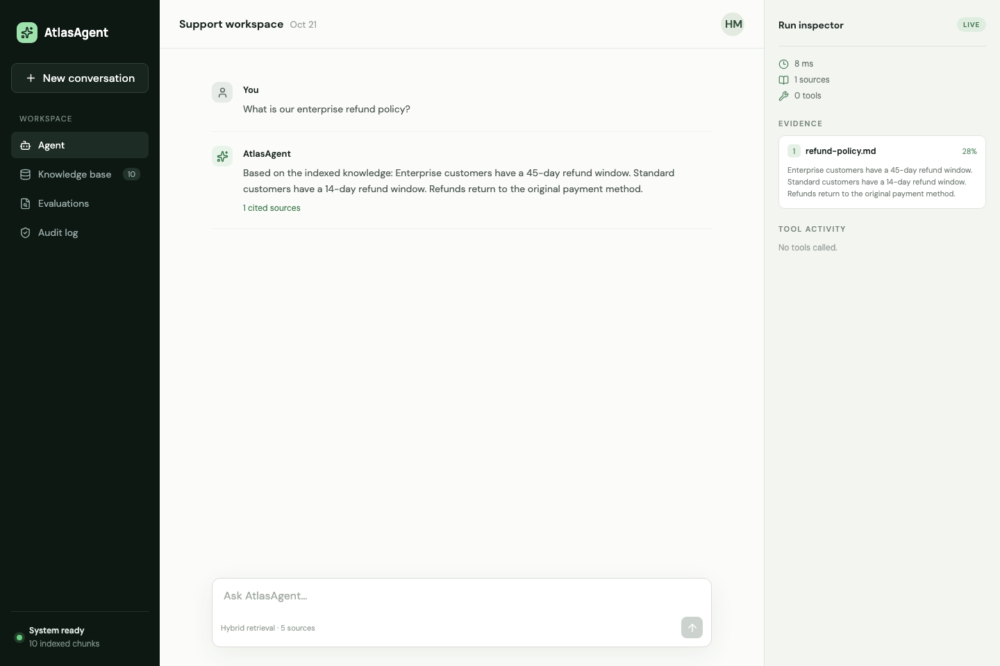
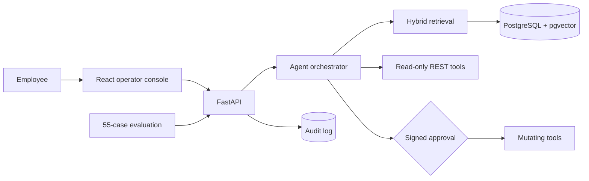

# AtlasAgent

### Auditable enterprise RAG and workflow automation

AtlasAgent turns internal documents and business APIs into a grounded employee assistant. It can
answer policy questions with ranked citations, inspect fictional customer and order records, and
propose write actions that remain blocked until a human supplies a signed approval.




## Why this project exists

Enterprise assistants need more than a chat box: they need measurable retrieval, visible evidence,
safe tool execution, and an audit trail. AtlasAgent packages those concerns into a runnable
full-stack project with a deterministic offline mode and an optional OpenAI-backed mode.

| Capability | Implementation |
| --- | --- |
| Knowledge ingestion | PDF, Markdown, text, JSON, and CSV normalization with overlapping chunks |
| Retrieval | Semantic, lexical, and weighted hybrid ranking with metadata filters |
| Grounding | Source excerpts, document identities, scores, and answer citations |
| Agent tools | Customer/order reads plus approval-gated support-draft creation |
| Governance | Single-use signed approvals and structured prompt/tool/execution audit events |
| Evaluation | 55 fixed cases measuring Recall@K, irrelevant-query rejection, and latency |
| Operations | FastAPI, React/TypeScript, PostgreSQL/pgvector, SQLite, Docker, and CI |

## Architecture



The local provider uses deterministic hash embeddings and extractive answers. Set
`ATLAS_LLM_PROVIDER=openai` to use OpenAI embeddings and grounded generation through the same
interfaces. Both providers produce 128-dimensional vectors so they share a storage schema.

## Measured baseline

The committed local run is reproducible from the fixed corpus and dataset:

| Metric | Result | Brief target |
| --- | ---: | ---: |
| Retrieval Recall@5 | **94%** | ≥90% |
| Irrelevant-query rejection | **100%** | — |
| Retrieval p95 latency | **6.85 ms** | <500 ms |
| Backend coverage | **92%** | ≥85% |
| Unauthorized write tests | **0 successful writes** | 0 |

These results were measured with SQLite and the deterministic provider on 2026-10-21. They are
not presented as production-scale performance. The full artifact and failed case IDs are in
[`evaluation/results/hybrid-top5-2026-10-21.json`](evaluation/results/hybrid-top5-2026-10-21.json).

## Quick start

### Docker

```bash
cp .env.example .env
docker compose up --build
```

Open the dashboard at <http://localhost:5173> and API docs at <http://localhost:8000/docs>, then
seed the fictional demo corpus:

```bash
docker compose exec api python scripts/seed_demo.py
```

### Native development

```bash
make install
make run-api          # terminal 1
make run-ui           # terminal 2
make seed             # terminal 3, after the API is ready
```

Try these prompts:

- `What is our enterprise refund policy?`
- `Show me order ORD-2048`
- `Create a support draft for CUST-1001`

For the approval walkthrough, use the pending action ID returned by the agent:

```bash
.venv/bin/python scripts/approval_token.py ACTION_ID
```

Paste the resulting local-demo token into the Run Inspector. See the
[two-minute demo script](docs/demo.md) for the complete portfolio walkthrough.

## Optional OpenAI mode

```bash
cp .env.example .env
# Set OPENAI_API_KEY and ATLAS_LLM_PROVIDER=openai in .env
docker compose up --build
```

OpenAI mode uses the Responses API for grounded answers and the Embeddings API for retrieval.
Documents must be re-indexed when changing embedding providers because stored vectors are
provider-specific. Local deterministic mode remains the default so cloning and testing do not
require credentials or incur API charges.

## Evaluation and quality

```bash
make test
make build
.venv/bin/python evaluation/run_retrieval.py --seed --method hybrid --top-k 5
```

CI runs backend tests, linting, the TypeScript production build, and container builds on every pull
request. Model-dependent evaluations are intentionally separate from deterministic unit tests.

## Design decisions and limits

- The mock CRM/order data is intentionally fictional and in-process so the workflow is easy to demo.
- The signed local approval token proves that writes cannot bypass the approval state transition;
  production should replace it with identity-bound, short-lived authorization.
- SQLite keeps local setup fast. PostgreSQL uses a native pgvector column through a dialect-aware
  SQLAlchemy type.
- Redis is included in the deployment topology for future queued ingestion; background workers are
  not claimed as implemented.

More detail is available in the [architecture notes](docs/architecture.md). Security expectations
are documented in [SECURITY.md](SECURITY.md), and contributions are welcome under the
[MIT license](LICENSE).
