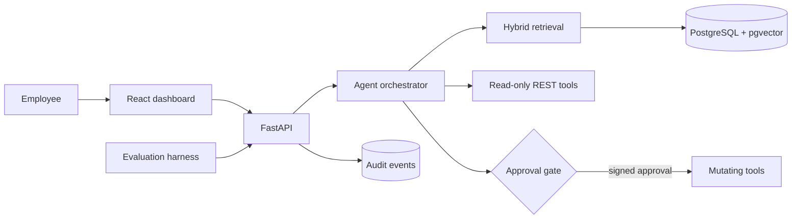

# Architecture

## Trust boundary

Retrieval and read-only business lookups can execute immediately. A mutating tool only creates a
`PendingAction`; it cannot call its handler until an HMAC approval token is validated. Actions are
single-use, and both agent decisions and executions are written to the audit log.

## Retrieval

Documents are normalized, split at paragraph boundaries with configurable overlap, embedded, and
stored with source metadata. Search supports lexical, semantic, and weighted hybrid ranking plus
exact metadata filters. The default hash embeddings are deterministic and offline-friendly; the
OpenAI implementation uses `text-embedding-3-small` with the same 128-dimensional storage shape.

## Answer providers

Deterministic mode produces an extractive answer from the highest-ranked passages, making local
tests repeatable and free to run. OpenAI mode sends the question, numbered evidence, and tool
results through the Responses API with explicit grounding instructions. Provider selection happens
at application startup, and documents must be re-indexed after switching embedding providers.

## Known production gaps

This repository demonstrates the architecture rather than claiming production readiness. A real
deployment still needs identity-bound authorization, document-level access control, tenant
isolation, prompt-injection defenses, rate limiting, secret management, migrations, and an external
audit/event sink.

